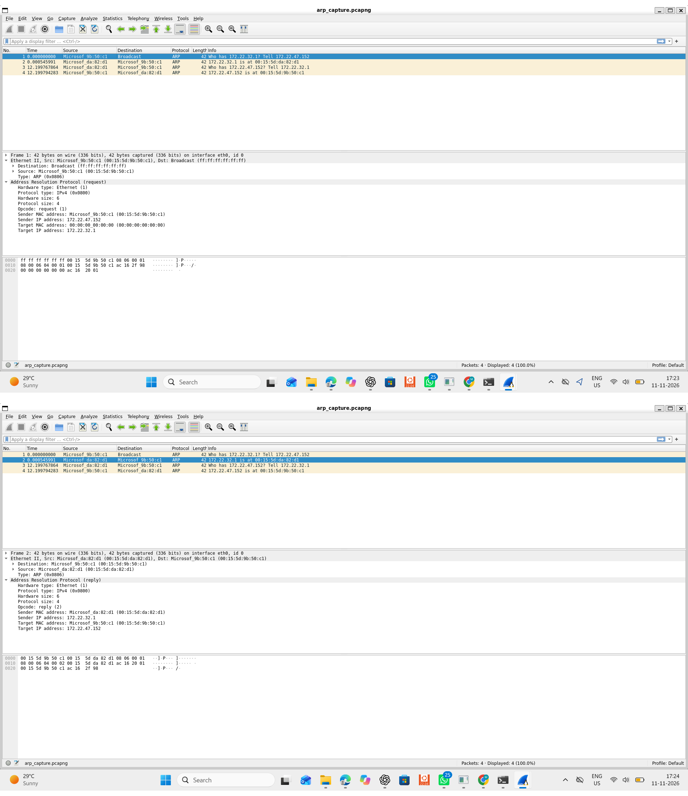
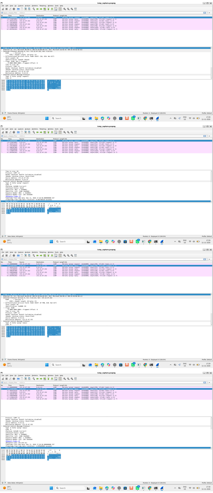
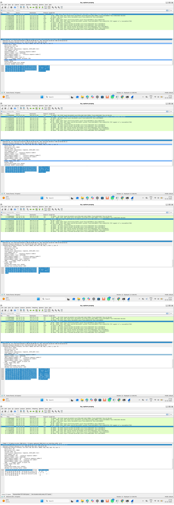
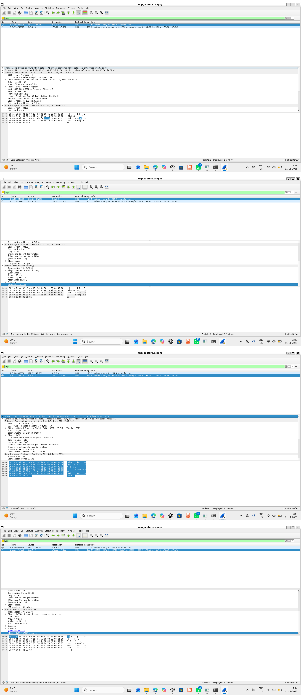

# Ethernet Communication Investigation and Traffic Analysis Using Linux

## Project Information

- **Student:** Mrudula Bhandurge
- **Roll Number:** BE203
- **Department:** Electronics and Telecommunication Engineering
- **College:** MMCOE, Pune
- **Academic Year:** 2026–27

## 1. Project Overview

This project investigates Ethernet network interfaces in Linux and captures and analyses different types of network traffic using Wireshark, TShark, and tcpdump.

The four protocols studied are:

- ARP – Address Resolution Protocol
- ICMP – Internet Control Message Protocol
- TCP – Transmission Control Protocol
- UDP – User Datagram Protocol

## 2. Software and Tools Used

- Ubuntu 22.04.5 LTS (WSL2)
- Wireshark
- TShark
- tcpdump
- Linux networking commands

## 3. Network Investigation

The following Linux commands were used:

```bash
ip link show
ip addr
ip route
ip -s link show eth0
arp -a
ping -c 4 8.8.8.8
ss -tuln
netstat -tuln
hostname -I
```

## 4. Protocol Capture and Analysis

| Protocol | Capture File | Packets |
|---|---|---:|
| ARP | `arp_capture.pcapng` | 4 |
| ICMP | `icmp_capture.pcapng` | 8 |
| TCP | `tcp_capture.pcapng` | 12 |
| UDP | `udp_capture.pcapng` | 2 |

### ARP Analysis

Captured ARP request and reply packets to observe IPv4-to-MAC address resolution.



### ICMP Analysis

Used the ping command to generate ICMP Echo Request and Echo Reply packets.



### TCP Analysis

Generated HTTP traffic using curl and observed the TCP three-way handshake, HTTP request-response, and connection termination.



### UDP Analysis

Generated a DNS query for `example.com` using UDP port 53 and analysed the DNS request and response.



## 5. Packet Capture Validation

All four capture files were checked using TShark protocol hierarchy statistics.

| Capture | Protocols Observed |
|---|---|
| ARP | Ethernet → ARP |
| ICMP | Ethernet → IPv4 → ICMP |
| TCP | Ethernet → IPv4 → TCP → HTTP |
| UDP | Ethernet → IPv4 → UDP → DNS |

## 6. Project Reports

- [Study Report](docs/Study_Report.pdf)
- [Analysis Report](docs/Analysis_Report.pdf)

## 7. Repository Structure

```text
ethernet-communication-analysis/
├── README.md
├── docs/
│   ├── Study_Report.pdf
│   └── Analysis_Report.pdf
├── screenshots/
│   ├── arp_analysis.png
│   ├── icmp_analysis.png
│   ├── tcp_analysis.png
│   └── udp_analysis.png
└── wireshark/
    ├── arp_capture.pcapng
    ├── icmp_capture.pcapng
    ├── tcp_capture.pcapng
    └── udp_capture.pcapng
```

## 8. Conclusion

The project successfully captured and analysed ARP, ICMP, TCP, and UDP traffic in a Linux environment. The packet captures were validated using TShark, and the observations were documented in the study and analysis reports.
